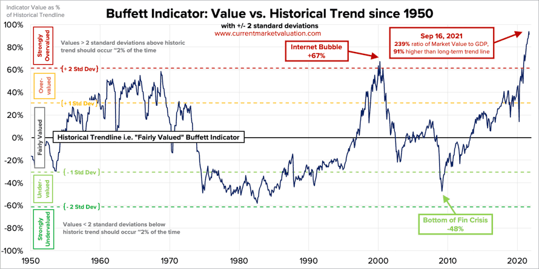
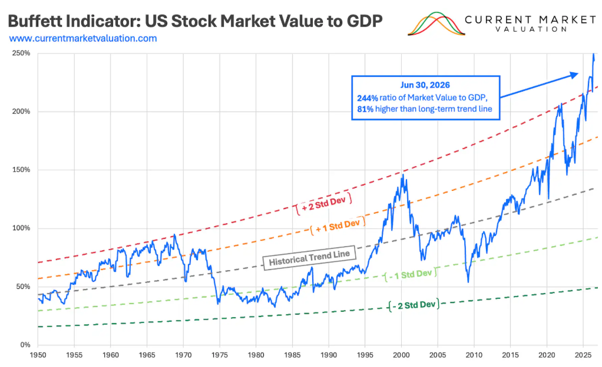
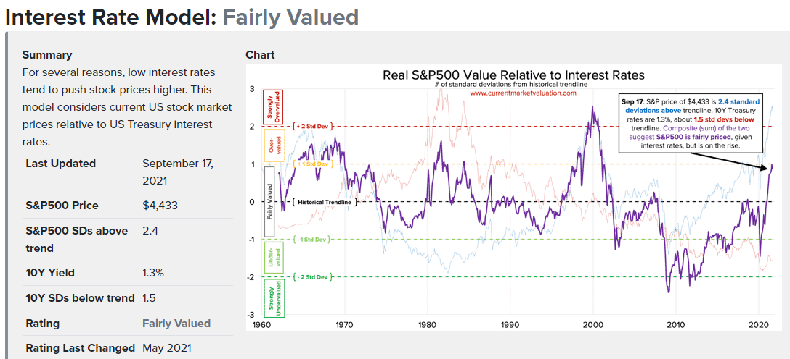
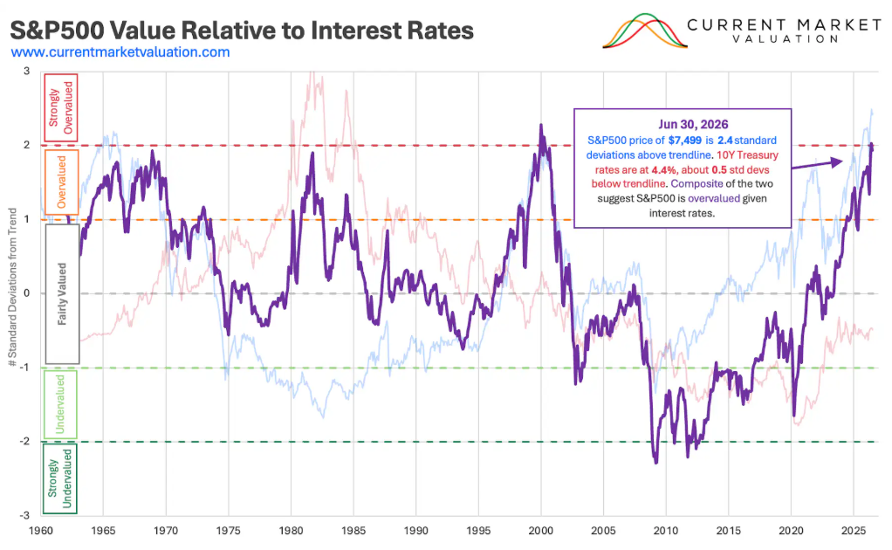

## Buffett Indicator
The Buffett Indicator is the ratio of a specific countries total stock market valuation to GDP.

For USA as of September 16, 2021
```sh
Aggregate US Market Value = $54.9T
Annualized GDP            = $22.9T
------------------------------------------
Buffett Indicator: $54.9T ÷ $22.9T = 239%
------------------------------------------
```
It suggests Market is highly overvalued. 



One of the primary criticism about Buffett Indicator is, it does not address the state of non-equity asset markets. In truth, investors have many different asset classes to consider and evaluate when considering portfolio distribution - e.g., corporate bonds, real estate, and commodities.

**Updated**: 2026/10/11



## Interest Rates

The 50,000ft overview on interest rates is as follows. When interest rates are high, bonds pay a high return to investors, which lowers demand (and prices) of the riskier equities. Additionally, higher interest rates means it's more expensive for businesses to borrow money, making it harder to borrow cash as a way to finance growth. Which is to say any business that takes on debt will face relatively higher interest payments, and therefore less profits. And again, less profits means lower stock prices. The corollary to all this is also true. Low interest rates means bonds pay less to investors, which lowers demand for them, which raises stock prices in relation to bonds. Low interest rates make it easy for corporations to borrow cash cheaply to finance growth. Corporate interest payments will be low, making profits high. This is all to say, if interest rates are high, stocks go down. If interest rates are low, stocks go up.

There are two core reasons that stock markets and interest rates tend to move inversely with one another.

* Lower Profits. As market interest rates rise, that means that firms who wish to borrow money in order to fund profitable projects will need to pay more in interest payments. This will necessarily lower profits. In some cases, it means the firms will not be able to do the project at all. Lower profits mean lower stock prices, since stock prices are fundamentally a measure of all future profits of a firm. The opposite is true as well - as rates fall firms are able to borrow more, which increases profits and expands economic output.

* Less Demand. As market interest rates rise investors are able to earn higher yields by investing in debt instruments (bonds, etc) rather than equities (stocks). This lowers the demand for stocks, which lowers their prices. Likewise, when interest rates are very low, investors seeking a return on their cash don't have many available choices, and tend to get pushed into riskier assets (lower quality bonds, stocks), in order to make a return. This drives those prices higher.

US interest rates are currently near all-time lows. Broadly speaking, this means that investments made in low risk products (e.g., bonds) are paying little in returns, and so are not highly demanded by investors.

Below is a composite chart which suggests US stock market is Fairly Valued. The two relative performance indicators for interest rates (red) and stocks (blue) have been combined, showing a composite value in purple.



When greater than zero, this indicates that rates are high, and stocks are also high. The peak here is during the 2000 internet bubble. During this time stocks prices were very high, but bond prices were right around average... meaning that even though investors had other good options to invest in, and despite the high interest rates firms needed to pay in order to borrow money, stocks were still very high. That's a clear bubble - which we all know in retrospect popped loudly and abruptly.

On those merits, we are not in a similar bubble today. As of September 17, 2021, the 10Y Treasury bond rate was 1.3%, which is 1.5 standard deviations below normal. Likewise, the S&P500 value of $4,433 is 2.4 standard deviations above its own respective trendline. Summed together, this gives a composite value of 0.9 standard deviations above normal, indicating that stocks are currently Fairly Valued.

**Updated**: 2026/10/11




**Sources** : 
1. [Buffett Indicator - currentmarketvaluation.com](https://www.currentmarketvaluation.com/models/buffett-indicator.php)
2. [Interest Rates - currentmarketvaluation.com](https://www.currentmarketvaluation.com/models/10y-interest-rates.php)
