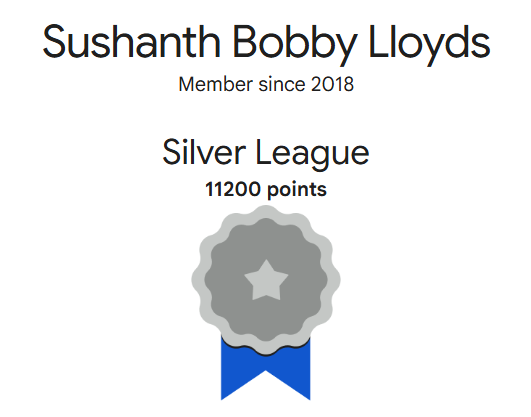
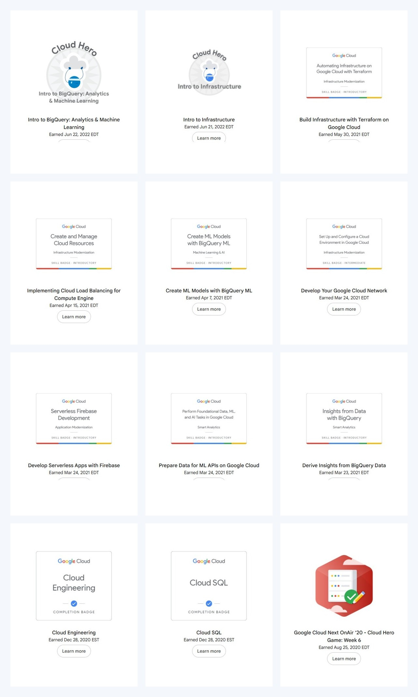
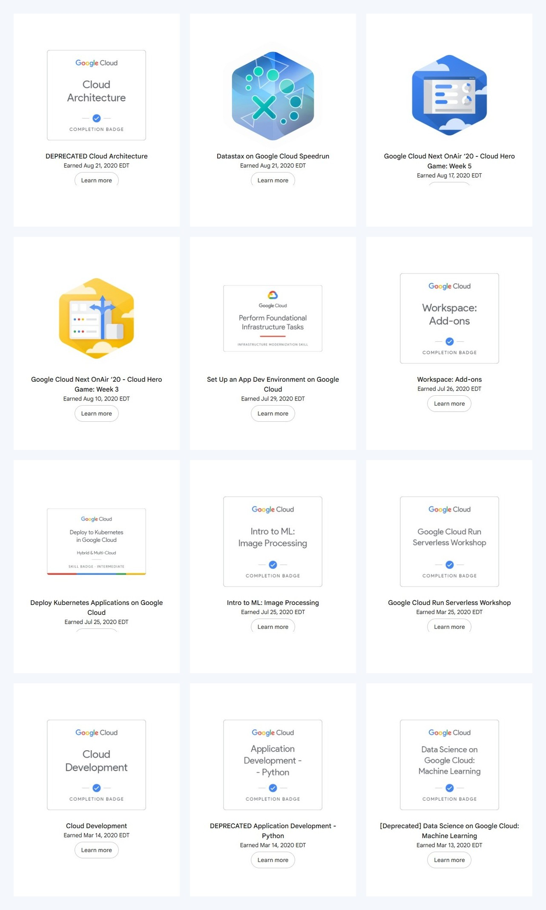
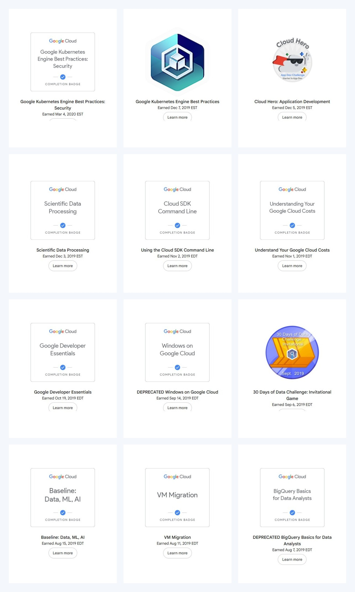
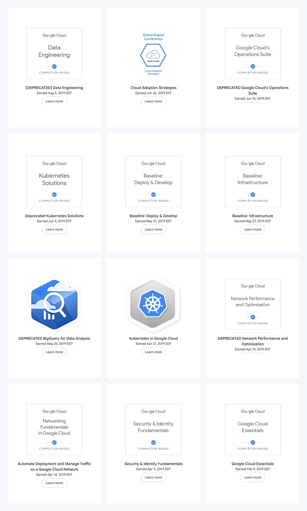

My <a href="https://www.skills.google/public_profiles/ce5ee3f8-a0e8-4f4c-b6f8-2f4dc8fb948d?locale=en" target="_blank">Google Cloud Skills public profile</a> is a record of the hands-on learning I completed across Google Cloud. At the time of this snapshot, the profile contains **48 badges**, shows **Silver League**, and has **11,200 points**.

The badges span a little over three years, from **Google Cloud Essentials** in February 2019 to **Intro to BigQuery: Analytics & Machine Learning** in June 2022. Together they cover several areas I kept returning to:

- Cloud infrastructure, architecture, networking, load balancing, and Terraform
- BigQuery, data engineering, machine learning, and ML APIs
- Kubernetes, Cloud Run, Firebase, and application development
- Cloud SQL, operations, cost management, migration, and cloud adoption

Some older learning paths have since been renamed or deprecated. I have kept their titles exactly as they appear on the public profile because they are part of the timeline.

## Badge gallery

<!--  -->

### Badges 1-12

### Badges 13-24

### Badges 25-36

### Badges 37-48

I was able to do all this by basically getting coupons while attending Google Worldwide Conferences online and free trainings. It was definitely worth it. 

### Thank you