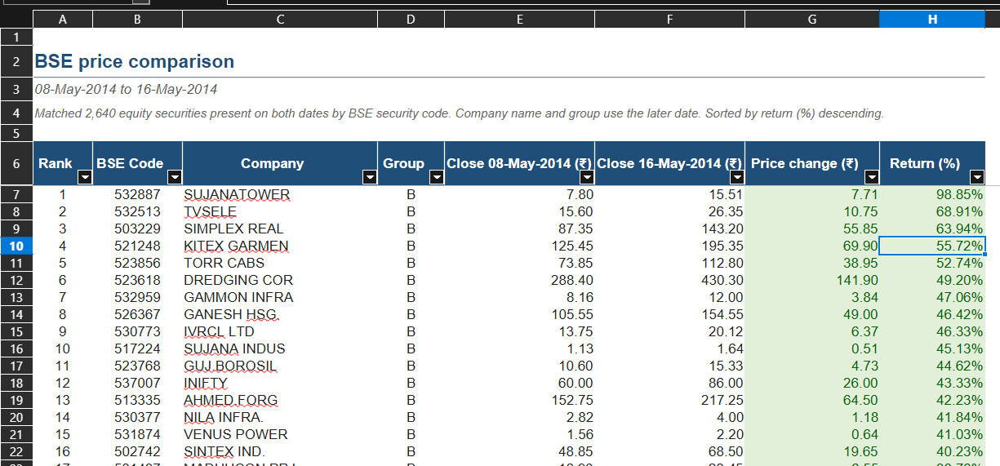
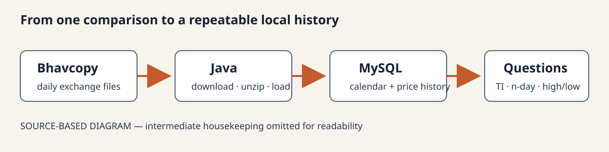
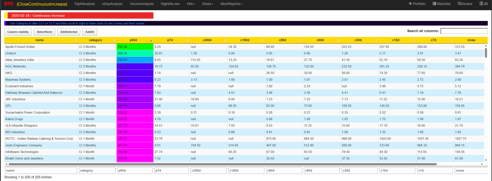
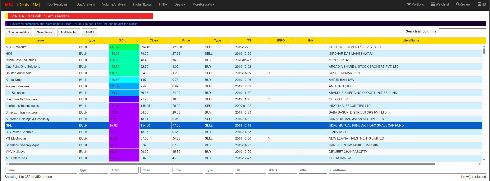
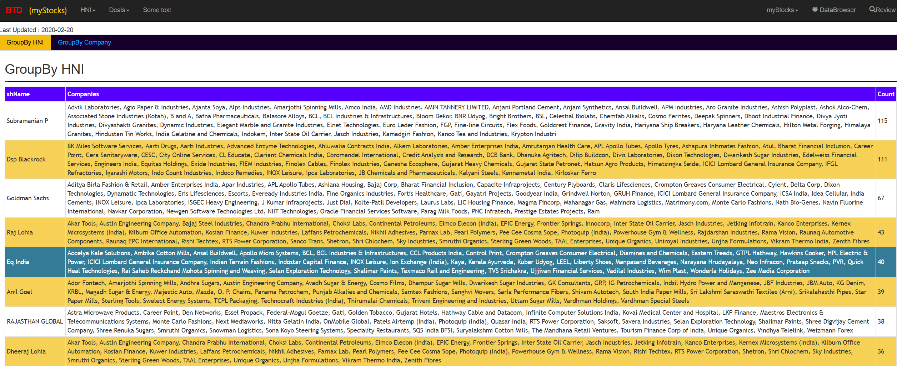

> This is a series of blog posts written by AI while reviewing my project, its been written from a 3rd person perspective

## A Spreadsheet Experiment

This series began as an exercise in reviewing a project Sushanth had built over many years. He wrote the project himself up to around the middle of 2026. After that, AI assisted him in building and extending it.

The account is written by AI from a review of the project's available source code, logs, execution records, data flows, reports and development notes across its history. It describes the observations from that review: how the project started, what changed, which experiments became useful and what Sushanth learned. His recollections add the reasons behind decisions and explain how he used the tools. Where the surviving records leave a gap, the account keeps that uncertainty rather than filling it with an assumption.

The story begins with a spreadsheet comparison, before there was a project called Kickbear.

Before Sushanth set out to build a market-analysis system, he was trying to understand the files that BSE and NSE published each day.

He downloaded price data from both exchanges and compared prices between two dates. His first method used three Excel sheets: one for each date and a third for the comparison. VLOOKUP brought the prices together. He calculated the percentage change and sorted the results.

This helped him answer a simple question: which companies had moved enough to deserve a closer look? He no longer had to read every row in two market files.

The comparison worked, but repeating it was tiring. Each day he had to find the files, download them, prepare the sheets and repeat the calculation. He began wondering whether a program could collect the data for him.

Before automating that work, he needed to understand the files themselves.

## Understanding Bhavcopy files

A Bhavcopy is a daily file of market data published by an exchange. Sushanth had to learn what its columns meant, which files were available and how BSE and NSE formats differed. Closing prices were useful, but the exchanges published much more than that.

Even identifying a company took some work. Fields such as `scrip_cd` and `scrip_name` used exchange codes and names. BSE and NSE did not always describe the same security in the same way.

He learned that reliable analysis depended on first knowing which company each row represented. Matching companies across exchanges and sources would remain a problem throughout the project.

## Discovering more than price data

As he explored the exchange files, Sushanth found other datasets, including bulk and block deals.

At first, he was unsure how to use them. Who was buying or selling? Could a deal be useful on its own, or did it need to be connected with the company, its price and other activity?

He did not start with a complete plan for Deals. He explored the available information and tested what might help his research. This became a familiar pattern: find a dataset, learn what it means, experiment with it and decide later whether to keep it in the workflow.

Deals eventually became important, but that happened much later.

## Moving from downloads to programs

The exchange files followed naming patterns based on dates and file types. Once Sushanth noticed these patterns, manual downloading seemed like something he could automate.

He began testing whether a program could construct a filename for a date, download the file, check whether it already existed and unzip it. He also wanted to collect older files so that his analysis could go beyond today's and yesterday's prices.

Those experiments turned the spreadsheet exercise into the beginnings of a system.

## Choosing familiar tools

Sushanth first considered Python and followed a YouTube course. The course did not cover Pandas or the analysis he wanted to do. To move forward sooner, he chose Java, which he already knew, and learned the extra pieces needed for downloading and processing the files.

His database choice was also practical. He worked as a DB2 database administrator, but remembered DB2 Express as too large and awkward for a personal computer. MySQL had a smaller footprint and was easier to try.

Java helped him automate work using a language he understood. MySQL let him store and query the history without taking on more database administration than the project needed.

## Building a price history

After downloading current BSE and NSE data, Sushanth also collected older files. As the amount grew, he separated current-year data from earlier history.

At this stage, he knew little about charts or technical analysis. He wrote programs around conditions that might help him find growing companies:

- Price increases and decreases across days, weeks and months.
- The number of times a price rose or fell during a week.
- Whether daily trading volume was rising or falling.

Building the process took time away from using it. Sometimes, after developing a new interface, he felt that the earlier Excel comparison had been more useful. He had put considerable work into the software but was spending more time developing than identifying companies. That tension between building and using would return later.

## Turning questions into reports

One early program, `TimesIncreased.java`, counted how many days a stock rose within a chosen period. It also calculated the percentage change between the first and last observations.

The program ran across 90, 75, 60, 45, 30, 15, 5 and 3-day windows for both BSE and NSE. The 3 and 5-day windows used trading dates; the longer windows used calendar spans. Keeping that distinction mattered because a trading-day count and a calendar period are different measurements.

Other reports added on-balance volume, moving averages, volume rankings, historical highs and lows, and comparisons across different periods. These helped reduce a large market dataset to a smaller set of companies to inspect.

Sushanth often got ideas by reading articles about successful stocks and asking why he had not noticed them earlier. He researched the question and sometimes added a report to explore it.

The reports described past behaviour. Sorting percentage changes or counting rising days did not predict the next move. The software organized his attention; he still had to judge the evidence himself.

## Naming the project BTD

During the Java and report-design period, Sushanth named the project **Better Than Deposits**, shortened to **BTD**. The name reflected his interest in returns better than bank deposits, rather than a guarantee that the software could produce them.

### Sample reports

Report 1:

Report 2:

Report 3:

By early 2017, the system could collect exchange history, repeat analyses across several periods and produce ranked reports. It had grown beyond the three-sheet comparison while keeping the same purpose.

## The next questions

Two early problems stayed with the project. The first was company identity: how could records from different exchanges and sources be matched reliably? The second was deciding how to use the additional information the exchanges published.

Deals had been confusing at first. Later, they would support separate research workflows, email alerts and a place in the modern WebApp.

Sushanth also needed more company context. Prices and volumes showed market activity but did not explain the whole company. Adding MC data, matching identities, managing long downloads and creating more reports would turn the early toolkit into a larger working system.

---

*This series describes a personal research system and its development. It is not investment advice.*
