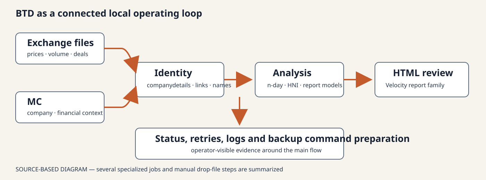
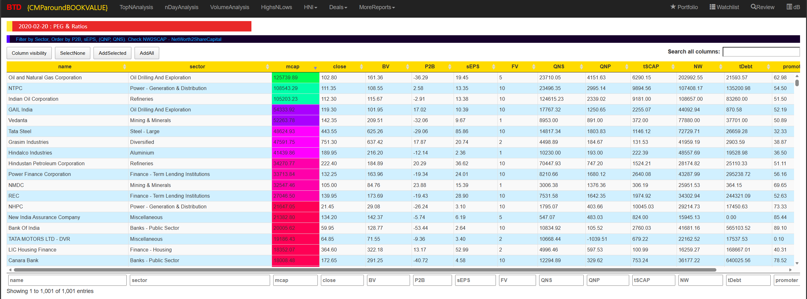
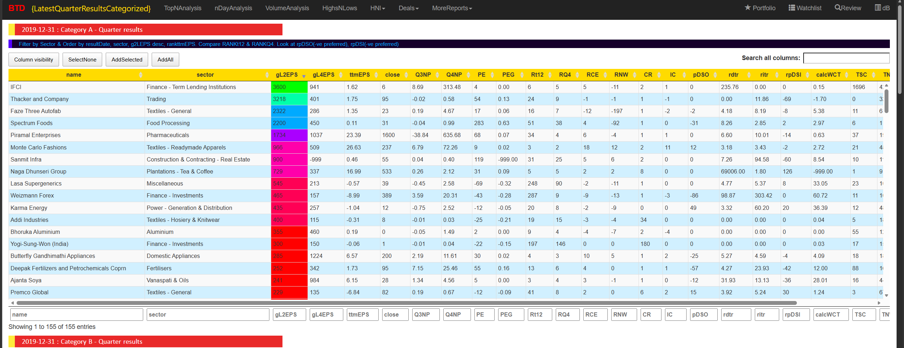
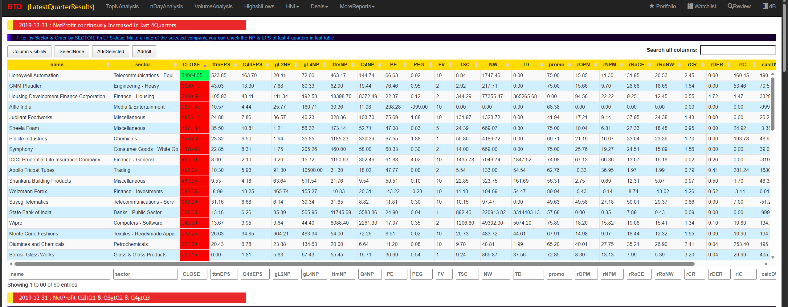

> This is a series of blog posts written by AI while reviewing my project, its been written from a 3rd person perspective

Sometimes the BTD programs needed to run on Sushanth's home computer while he was at the office. His father would start them and send photographs showing their progress.

The process could take hours. Sushanth's earlier routine was roughly 6:30 to 9 in the evening, but adding reports made the runs longer. As restarting and catching up became easier, he ran them whenever time allowed.

Downloading all the MC data initially took more than ten hours. He needed to reduce unnecessary downloads and run some work at the same time. Periodic reports were fetched only at their required intervals, homepage metrics were fetched monthly, and requests were spaced by about 20 seconds to avoid having his IP address blocked.

Even with these changes, the long waiting time remained frustrating.

## Combining market data with company information

The exchange files supplied prices, volume, delivery data and deals. They supported comparisons across days, highs and lows, and changes in volume. Sushanth wanted to connect those movements with information about the companies themselves.

MC supplied company pages, financial statements, ratios, results, holdings and related information. BTD therefore had two data-collection paths: exchange files and MC pages.

Before combining them, he had to match company identities. Exchange codes, symbols, ISINs, MC names and page links needed to refer to the same company. Tables named `companydetails`, `mc_links` and `mc_names` recorded those connections.

This matching work made the reports possible. Without it, the system would have held two separate collections of facts that could not be reliably compared.

## Downloading several pages at once

The first MC crawler fetched pages one after another. Sushanth replaced it with a design in which one part prepared the work and several workers fetched and processed pages at the same time. A fixed-size pool controlled the number of workers.

He was proud of learning and successfully applying this approach. It continued working for years without major issues.

However, parallel downloads did not remove the whole workload. Thousands of pages still needed to be read. Requests needed delays, and pages could fail or redirect. Later runs tracked progress, retried unfinished work and gave each worker its own database connection.

He learned that doing several tasks at once was helpful, but deciding which tasks were necessary mattered just as much.

## Running only work that was due

Different sources needed different update schedules. Some were daily, others weekly, monthly or less frequent. A table named `files2download1` stored those rules, while `etl_tasks` tracked progress and status.

The download rules included an explicit override, always-download and never-download settings. Otherwise, they checked the time since the last download: more than zero days for daily files, more than seven for weekly files, more than 30 for monthly files and more than 60 for every-two-month files.

This meant the schedule could be changed in stored settings instead of rewriting every downloader. Pages that were not due did not need another request.

## Joining the steps into one local process

BTD grew beyond downloading pages. Its main run collected exchange files, performed housekeeping, prepared MC work, fetched due pages, ran analysis and calculated comparisons across different periods.

It then did further processing, updated the tables used by the reports, generated HTML in a separate step, wrote logs and prepared backup commands. Some specialized jobs and file steps still required manual work.

*The diagram summarizes the main steps; some smaller jobs and manual file handoffs are omitted.*

Sushanth had built a stock-research system that collected data, organized it, analyzed it and produced reports. Logs, retry status and backup preparation helped him operate it on a home computer.

## Reports using MC data

### Report 1

### Report 2

### Report 3

## Making room for the next tools

Python did not replace Java in one move. From 2020, it began taking over selected analysis and preparation tasks. Java continued collecting exchange and MC data and generating Velocity HTML reports during that transition. Saved execution records show Java running into 2024. Sushanth no longer executes Java programs today.

The existing tables and files helped the two languages coexist. A Python program could fill the same table that a Java report already read. The program producing the data could change before the report did.

Another limitation was becoming clear. HTML reports displayed information, but they did not easily remember whether Sushanth had reviewed a company, what he thought of it or which announcement needed attention.

The next version of Kickbear would add a company-focused application and saved research state. For a period, that application and the existing reports would run alongside each other.

---

*This article describes historical research software. Its screens and labels are not investment advice.*
