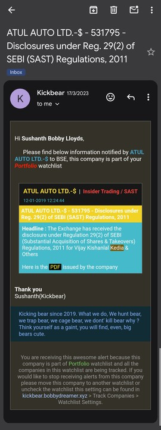
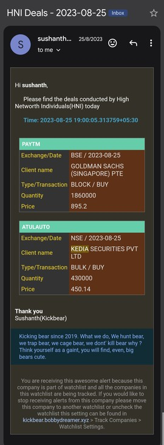
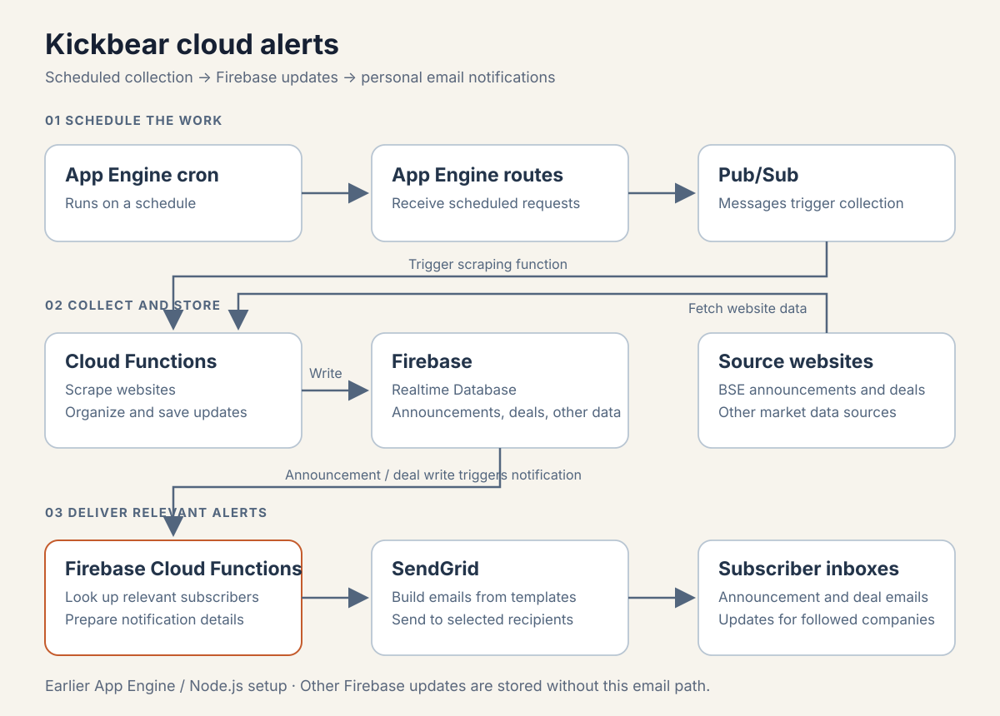
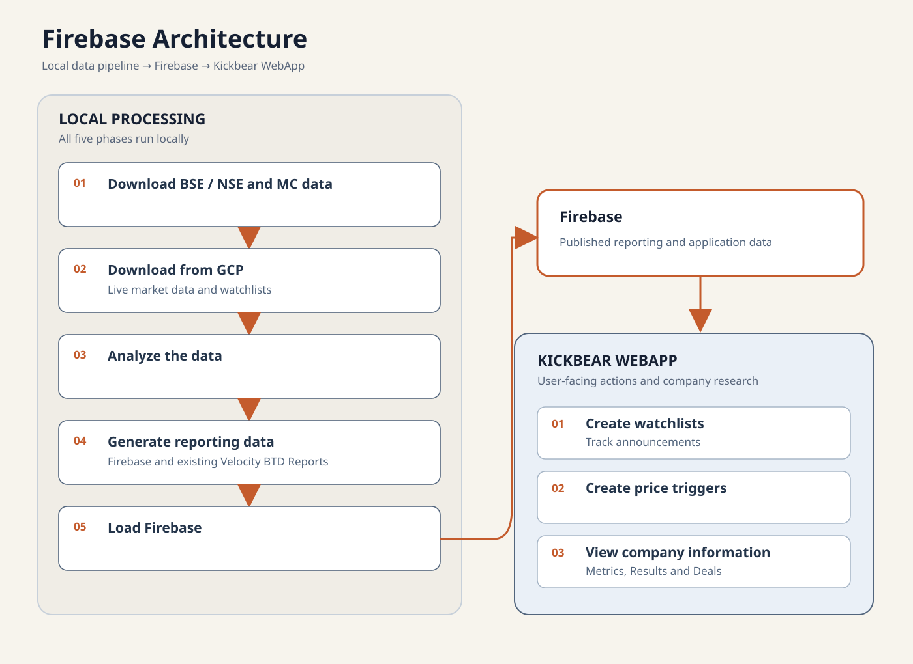
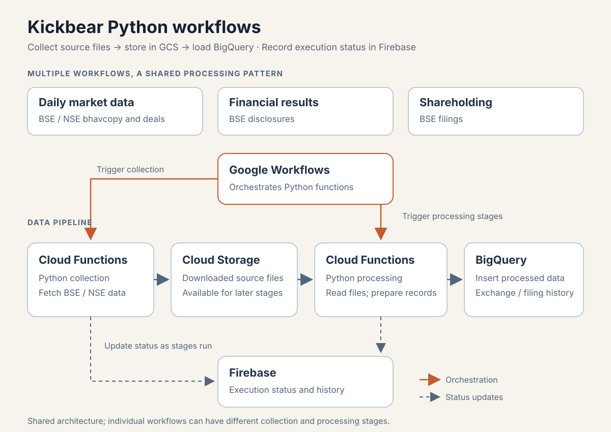

> This is a series of blog posts written by AI while reviewing my project, its been written from a 3rd person perspective

Firebase introduced Sushanth to a different way of building an application. When stored data changed, connected users could receive the update immediately. A function could also respond to that change and perform another task.

That idea led him into Google Cloud Platform, or GCP. Instead of opening a report to check every update, he could arrange for useful information to reach him.

## Monitoring BSE announcements and deals

Sushanth used a Google App Engine schedule to trigger Cloud Functions every 30 minutes between 9 AM and 5 PM, and every hour between 5 PM and 9 AM. The functions read the BSE announcements page and saved new information in Firebase.

Firebase also stored the companies each user wanted to follow. When a new announcement arrived, a Firebase function checked the subscribers and sent an email through SendGrid. The users were mainly Sushanth, his sister and his mother, who acted as test users.

He used the same approach to monitor BSE bulk and block deals.

*App Engine scheduled collection; Firebase changes drove announcement and deal notifications for subscribed companies.*

Sushanth recalls that this worked smoothly for about seven years, with only a few changes along the way. BSE changed its announcement website, and the SendGrid setup needed to be redone after Twilio acquired the service.

Building it required a great deal of self-learning. The cloud skills he gained also helped him earn a Google Associate Cloud Engineer certification.

## Choosing Firebase for Kickbear

The success of the alerts encouraged Sushanth to move beyond Java-based Velocity reports. The existing data was in local MySQL, so he considered how a cloud application could access it.

One option was a virtual machine running MySQL. Another was Cloud SQL, but its cost was difficult to justify for a personal development project used mostly by him and the programs updating it. Firebase was the cloud database he knew.

He chose Firebase based on cost and familiarity, while recognizing that he would need housekeeping rules to keep the stored data within reasonable limits.

## Organizing data around the screen

Sushanth's experience as a DB2 database administrator shaped how he understood the difference. In a relational database, data is usually split into related tables to reduce duplication. For Firebase, he planned the stored structure around what each screen needed to read.

Some data was deliberately duplicated. A company page could then fetch its information from one place instead of reading several branches and assembling everything in the browser.

### Company information

The main company branch was `BTD_Metrics/{code}`, where the code could be a BSE scrip code or an NSE symbol. It brought together:

- Name, ISIN, symbol, sector, website and chart link.
- Closing price, previous close and last-traded date.
- Market capitalization, earnings per share, book value, company and industry P/E, dividend, face value, price-to-book and last-update details.
- Quarterly sales, profit, interest, tax, tax rate and diluted earnings per share under `QFin`.
- Yearly sales, profit, interest, tax, exceptional items and diluted earnings per share under `YFY`.
- Yearly balance-sheet values under `YBS`, with stored fields `scap`, `NW`, `Debt`, `TR`, `TP` and `BV`.
- Yearly ratios under `YRatios`, including net profit margin, price-to-sales, return on capital employed and return on net worth, with stored fields `NPM`, `PSR`, `RoCE`, `RoNW` and `EE`.
- Further balance-sheet, growth, ratio and cash-flow information.
- Price trends for 3, 5, 15, 30, 60, 90 and 365-day periods, promoter holdings, HNI information and screening data.

Keeping these details together supported a company-focused view.

### Announcements by date and company

Announcements were stored in separate branches because the UI supported both ways of browsing:

- `BTD_BSEAnnouncementsByDate/{date}/{announcement}` for a day's announcements.
- `BTD_BSEAnnouncementsByCode/{company}/{announcement}` for a company's announcements.
- `BTD_BSELatestAnnouncement` for the latest information.

### Watchlists and subscriptions

Watchlists also had several stored views. Under `BTD_Lists/{uid}`, the system kept the user's companies, named lists and tracking settings. A company entry included its name, ISIN, symbol, scrip code, watchlist, added date and initial comment.

`allCompanies` held company details, `lists/{list_name}` recorded membership, and `TrackLists/{list_name}` indicated whether a list should be monitored for price changes.

Two other branches served different purposes. `BTD_CodeUsers/{code}/{uid}` connected companies with users for personalized updates. `BTD_Subscribers/codeUsers/{code}/{uid}` recorded announcement subscriptions, while `BTD_Subscribers/code` marked subscribed companies.

Keeping these purposes separate mattered: belonging to a list, tracking its prices and subscribing to its announcements were related but different actions.

## How an announcement became an email

Emails covered three main areas: BSE announcements, price changes and HNI activity in deals.

When a new announcement was saved under `BTD_BSEAnnouncementsByDate`, the function looked up subscribers for its BSE scrip code. It copied the announcement to each user's named-list view and to that user's `ALL` view under `BTD_UserAnnouncements`. The copy began with its read status set to false, and housekeeping entries recorded the affected lists.

The notification process obtained email addresses from Firebase Authentication and used a prepared SendGrid template. The function supplied the announcement details and recipients; the template controlled how the email looked.

The important result was personal delivery: one source announcement could reach the relevant users and appear in their saved views.

## How local work and the cloud fitted together

The earlier Kickbear WebApp read its displayed data from Firebase. That data fell into two groups:

1. Market updates, such as announcements and information collected from websites, which mainly needed organizing and categorizing.
2. Analysis prepared locally and then uploaded to Firebase.

The local workflow still downloaded BSE, NSE and MC data. It also brought cloud market updates and watchlists back to the local system, performed analysis, prepared data for both Firebase and the existing Velocity reports, and uploaded the results.

In the WebApp, users could create watchlists for announcements, set price triggers and inspect company metrics, results and deals.

*The diagram shows the main data paths without exposing private Firebase records or identifiers.*

A saved export from 21 October 2022 contained 57 JSON snapshots totaling about 714 MB. It included 4,468 company metric objects and large results and announcements branches. These figures show the amount of data the system handled, but they do not measure how often each page was used or how many separate user actions occurred.

## Alerts that supported the research routine

Announcements and Deals Mail were among the most useful cloud features for Sushanth. Results, orders, order books, fire incidents, new clients and similar disclosures could prompt another look at a company. Price triggers also brought changes to his attention during the day.

Other implemented areas, including some real-time features and HNI/FII analysis, were used less effectively. The code shows what existed; Sushanth's recollection explains which parts helped his routine.

## Several stores with different jobs

Firebase did more than hold a copy for display. It stored application data, user actions, subscriptions, synchronization details and, later, workflow status.

MySQL remained important for detailed local analysis and MC processing during this period. HTML reports also continued. Data moved back from Firebase into local files and databases when needed.

This was a period of overlap. Firebase supported the browser application and personal state, MySQL supported local processing, and static reports remained useful for scanning many companies.

## Two stages of cloud development

The first cloud setup used App Engine's schedule to call a route. That route sent a message through Pub/Sub, a Node Cloud Function performed the work, and Firebase received the result.

The later setup used Cloud Scheduler and Workflows to coordinate Python functions. Google Cloud Storage, or GCS, kept files so that another stage could read or replay them. BigQuery held selected exchange and shareholding history and supported some analysis. Firebase also kept workflow status and history.

*Daily bhavcopy and deals, BSE financial results, and shareholding collection used the same broad pattern, with separate workflows for different jobs.*

Only selected jobs moved to the cloud. Detailed MC processing stayed local, and MySQL and Firebase continued their existing roles.

The useful improvement was recovery. A late exchange file could be retried, a saved original file could be processed again, and each stage could leave enough status information for the next step.

## Status records without a complete dashboard

The saved `btd-in3-admin` data contained 67,197 event entries, including 48,103 related to shareholding. These were individual stages and events, not 67,197 complete runs.

Despite all that history, there was no single screen showing the status of every batch, API and source. Sushanth wanted one, but checks remained manual and some unfinished status records became outdated.

He learned that saving more status information did not automatically produce a useful monitoring dashboard. The system had retries, checkpoints and history, but remained a personal project with gaps in its operating tools.

## Preparing for a Python research workflow

By this stage, Kickbear was both a data-processing system and an application. Python would next take over more work behind the existing tables and files. Notebooks would become research tools, and Streamlit would make their results easier to browse.

Separating data preparation from display would help those calculations survive further changes to the interface.

---

*This article describes a personal research system. Notifications, triggers and historical screens are not investment advice.*
