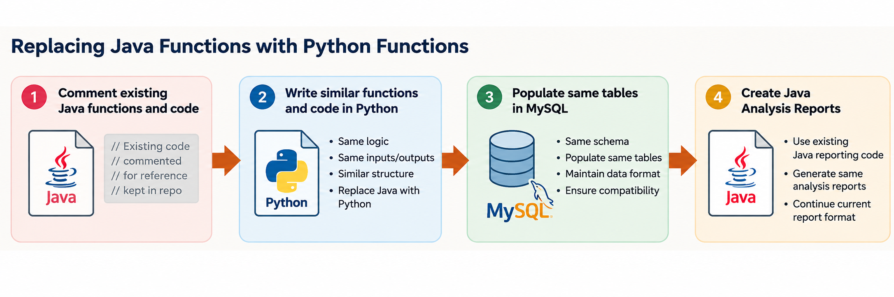
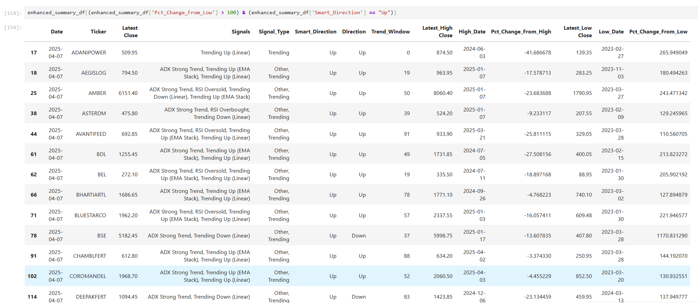
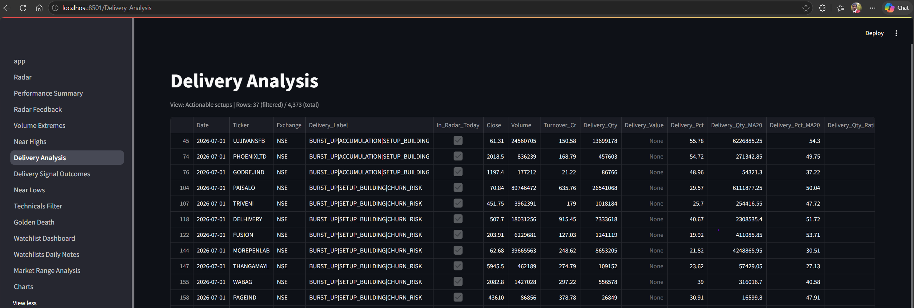
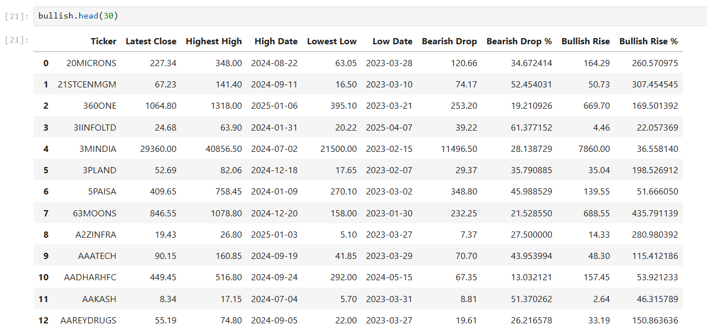

> This is a series of blog posts written by AI while reviewing my project, its been written from a 3rd person perspective

The move from Java to Python happened in pieces. One saved Java program, `BTDAnalysis.java`, contains sections marked “This is replaced with python” beside other Java analyses that were still running.

One of those sections called `TimesIncreased2`, connected to MySQL, ran the calculation for the chosen date and disconnected. Disabling that call did not mean removing the entire Java system. It showed that one job had moved to Python.

## Replacing one job at a time

From 2020, Python began taking on weekly aggregation, Times Increased, high/low calculations, Top-N tables, some company matching and cleanup, scheduling, PEG-related processing and report preparation. Java still collected data, performed detailed MC scraping and generated Velocity HTML reports during the transition.

The existing MySQL tables helped the two languages work together. Python could calculate a result, write a file and load it into the same table that a Java report already used.

For Times Increased, Pandas grouped the data by ticker and counted observations where the closing price was above the previous close. It also measured the percentage change between the first and last prices, rounded to two decimal places. The output included rising-day counts and change values for each selected window.

The result was written to `BTD_nse_TI.csv` and loaded into `nse_ti`. The old table contents were cleared, the file used pipe-separated columns, and its header was skipped during loading. Downstream reports could keep reading the familiar table.

This was a useful lesson: replacing the program that calculates a table does not always require replacing the reports that read it. Python eventually replaced Java, and Sushanth no longer executes Java programs.

## Pandas made the code easier to express

Sushanth had explored Python earlier without seeing a clear fit for this work. Pandas changed that. Its DataFrames made filtering, grouping, reshaping and joining full-market data easier to express.

He initially expected working in memory to reduce delays associated with SQL. During the migration, however, he saw that Python would not automatically make the complete batch faster. The Java programs had already handled parallel work well, and he had not encountered the same memory problems there.

Reading too much data, repeatedly copying DataFrames and recalculating every company still took time and memory. Python gave him more flexible ways to work, but reducing unnecessary work remained essential.

## Notebooks became a research tool

Between 2023 and 2025, Jupyter notebooks served two purposes: developing calculations and using those calculations for research. Trend Analysis was the area Sushanth used most. Saved charts show that the notebooks produced results he could review, rather than being only experiments with code.

A notebook made it easy to move from a question to a calculation and chart. It could also grow into a mixture of loading, cleaning, analysis, plotting, candidate lists, notes, exports and special cases.

Sushanth recalls that he did not organize the notebooks well. When one became slow, he often moved to another. Eventually, he decided that Jupyter could not remain the long-term interface.

That decision started **Kickbear 2.0**. At first, the plan was to put the many prepared analysis results into Streamlit. The name did not originally mean a React/FastAPI application.

## Early code and regular use happened at different times

The earliest surviving BTD-specific Streamlit implementation is from June 2025. By September, the project had a clear multi-page structure. Sushanth remembers experimenting with earlier Bullish/Bearish versions, but those versions no longer survive and cannot be dated or reconstructed reliably.

He places regular Streamlit use later, around the RadarSystem generation in December 2025. Code can exist for months before it becomes the interface someone opens routinely.

Streamlit helped him turn prepared tables and charts into navigable pages without building a separate frontend. It supported several useful stages of the project.

## The Bullish/Bearish view that felt useful

The first Streamlit view Sushanth considered particularly successful showed two measurements: how far the latest close had fallen from a historical high, and how far it had risen from a historical low.

For each company, the program found the latest closing price, the highest High and the lowest Low in the chosen history. It calculated:

- Drop amount: highest High minus latest close.
- Drop percentage: drop amount divided by highest High, multiplied by 100.
- Rise amount: latest close minus lowest Low.
- Rise percentage: rise amount divided by lowest Low, multiplied by 100.

A zero denominator left the percentage unavailable instead of producing an invalid result.

These measurements should be kept separate from the later High-Date/Low-Date classifier and the current Structural Direction model. All addressed what was rising or falling, but their rules were different.

## Moving beyond Streamlit

The main difficulty was navigation and layout. Sushanth wanted substantial information about one company together, dense tables, connected selection and panels that could scroll independently.

Streamlit had helped him build useful pages, but this combined workflow required a more flexible interface.

A financial Streamlit prototype existed by 2 August 2026. On 3 August, the design decision recorded as ADR-0005 described a dedicated application. The first React, FastAPI and SQLite implementation followed on 4 August.

The analysis did not need to move into that interface. Python programs already handled many calculations, and RadarSystem had already prepared data before display. The new WebApp could read those results rather than rebuild the analysis inside each page.

Streamlit and the new WebApp overlapped during the transition. Streamlit is now being fully replaced. The next article examines Financials, whose XBRL processing had already become a substantial project in its own right.

---

*This article describes research software and historical analysis. It does not provide predictive guarantees or investment advice.*
