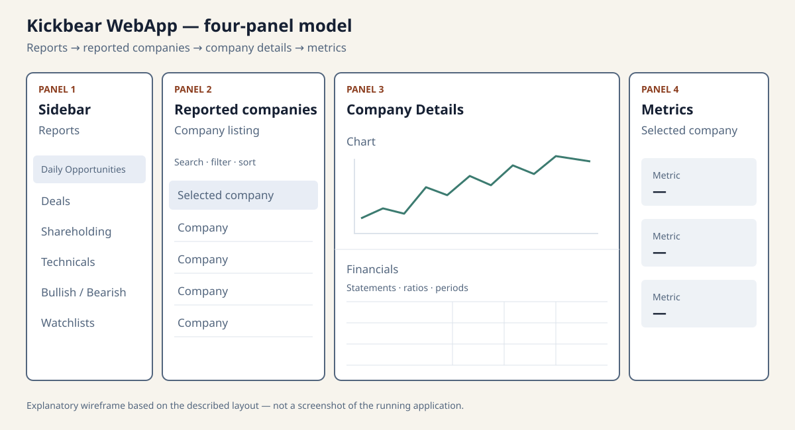
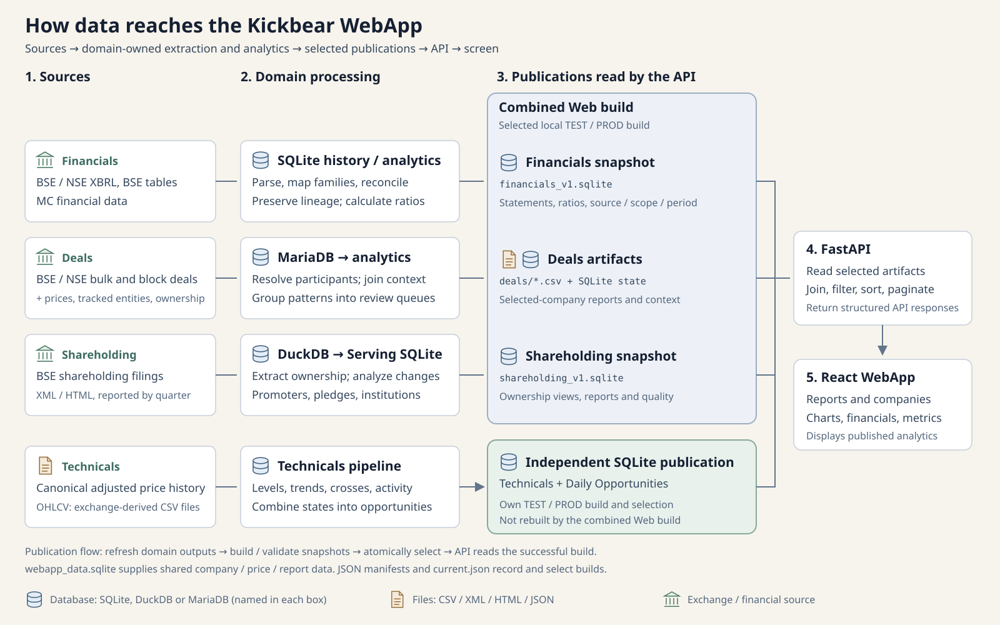
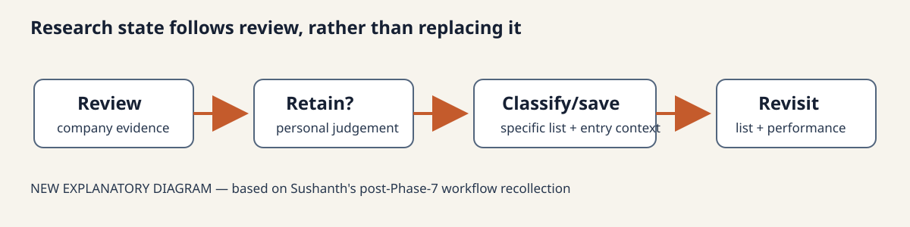

> This is a series of blog posts written by AI while reviewing my project, its been written from a 3rd person perspective

Sushanth wanted substantial information about one company on one screen. Streamlit had helped him turn analysis into an application, but arranging dense tables, connected selections and several panels became difficult.

The new WebApp grew from that need. XBRL supplied much of the financial evidence; the layout came from how he wanted to review companies.

## What data the WebApp uses

The programs behind Kickbear collect and process exchange and company data. The WebApp reads the prepared results through its local API, the connection between the browser and backend. Opening a company does not download new source files or rerun the analysis.

The feature inventory below describes the version inspected around 19–21 September 2026. It is not a complete audit of every later change.

| Data | Source | Information available |
|---|---|---|
| Company identity | Company records, exchange identifiers and TDF outputs | Names, NSE symbols, BSE codes, ISINs, the analytical `security_id`, the application's `entity_key` and the exchange selected for a period. These connect records for the same company. |
| Prices and market information | Prepared exchange price history and Trends chart files | Dated open, high, low, close and volume; chart history; latest close, date and daily change; historical highs and lows with dates; market capitalization; exact 5-, 20- and 60-session returns and daily speeds. Coverage depends on the company and source. |
| Financials | MC, BSE XBRL, BSE website tables and NSE XBRL | Annual and quarterly values, balance sheets, cash flow and ratios. Records retain business family, reporting period, standalone/consolidated basis, source, selected values, alternatives, conflicts and the path back to the source. |
| Shareholding | BSE XML/HTML filings | Reporting quarter, ownership categories, shares and percentages, promoter holdings and pledges, institutions, disclosed investors, shareholder participation, filing freshness and data-quality details. Named investors do not cover all beneficial owners. |
| Bulk and block deals | BSE/NSE transactions, combined with tracked participants, prices and ownership analysis | Company, participant, transaction date, buy/sell side, quantity and price, with participant types and grouped context. A transaction does not prove remaining holdings or intent. |
| Technicals and Structural Direction | Separate programs using prepared price history | Support/resistance, consolidation, trends, moving-average crosses and unusual activity; opportunity stages and reasons; confirmed Direction/State, protected reference points, pivots and pending confirmation. These are calculated results. |
| Personal research records | Actions in the WebApp | Reviewed and ignored companies, custom watchlists, memberships, Added Date, resolved Price Date and Entry Price. These belong to Sushanth's research rather than an exchange feed. |

## How the data is prepared

Each area has its own pipeline: a set of steps that turns source data into checked results. The programs match company identities, keep dates and source details, calculate the required measurements and save results for display.

| Area | Preparation steps |
|---|---|
| Identity and prices | Match exchange names and codes to stable identities; select the exchange using the TDF rules for that period; prepare adjusted prices and chart files; calculate highs, lows, distances, returns and speeds. Trading-session returns remain separate from calendar-day returns. |
| Financials | Read documents and tables; map values into the correct business-family statements; keep period, reporting basis and value details consistent; compare overlapping sources while preserving alternatives and conflicts; calculate supported ratios; save the Financials dataset. |
| Shareholding | Extract BSE filings into consistent records; organize quarters, categories and investors; calculate quarter-on-quarter and year-on-year changes; prepare promoter, pledge, institutional and investor observations; add freshness and quality information. |
| Deals | Combine exchange transactions, match companies and participants, join price and ownership context for the relevant dates, detect patterns and group them into a smaller review queue. This is a prepared report rather than the full transaction archive. |
| Technicals | Maintain each indicator and setup family, then bring their existing states together in Daily Opportunities. Eligibility and freshness rules control daily review. Failed setups remain visible alongside triggers and confirmations. |
| Structural Direction | Work through price history using pivot and counter-move rules; maintain internal and pending states; require confirmation before changing the public State; save summaries separately from detailed state and event records. |
| Web build and API | Collect the prepared files, check that they fit the expected formats and that inputs stayed unchanged, record the build and select it only after success. Requests join company information, filter, sort and return pages of rows. Watchlist summaries use saved entry information and published prices. |

A watchlist return is `(latest close - entry price) / entry price * 100`. The requested traded date supplies the entry price when available; otherwise the next available closing price is used. If there is no later price, the entry and return remain unavailable. The backend prepares this view without recalculating Technicals or Structural Direction.

## Where the data is stored

Kickbear uses different stores for processing, display and personal actions. A publication means a checked set of results saved for the application to read; it does not mean publishing them on the internet.

| Store or file | Purpose |
|---|---|
| Financial history and analysis SQLite | Stores source observations, analysis and source history. Normal WebApp requests do not read the whole history database. |
| `webapp_data.sqlite` and `financials_v1.sqlite` | Hold compact company, price and report data, and the prepared family-aware Financials views, in the selected Web build. |
| Shareholding Extraction and Analytics DuckDB | Hold consistent ownership records and their analysis. Deals also reads ownership context from the analysis tables. |
| Shareholding Serving SQLite and `shareholding_v1.sqlite` | Serving prepares results for consumers; the Web build creates the company snapshot used by the API. |
| Deals MariaDB, SQLite/CSV outputs and Web files | MariaDB supports deal events and current domain reports. Prepared reports and selected Web files support display. It has not replaced every other database. |
| Independent Technicals SQLite | Holds selected technical states, reports and company details. It is built and selected separately from the combined Web dataset. |
| Structural Direction CSV summary and SQLite records | The WebApp reads the selected summary. Detailed engine state and events stay in the processing system. Some displayed data therefore comes from files rather than database queries. |
| `user_state.sqlite` in each environment | Saves Reviewed Bucket, IgnoreList, custom watchlists, memberships and entry context. Rebuilding analysis does not erase these personal records. |

The browser receives API responses instead of opening these databases itself. The combined Web dataset, Technicals and Structural Direction can each have their own build and update schedule.

## Reports and company views

Reports help Sushanth choose companies to inspect. Company views explain the evidence behind the selected row.

| Area | Available views |
|---|---|
| Daily Opportunities | The main daily review list; Triggered, Confirmations, Retests, Failed / Risk and Near Trigger; Fresh Primary and Updated by New Evidence views to show why renewed review is useful. |
| Technicals | Support & Resistance, Consolidation, Trends, MA Crosses, Unusual Activity, Technicals Overview and Technical Events. Company details show participating families, states, levels and reasons. |
| Bullish/Bearish and Details | Structural Direction-backed discovery with Direction, confirmed State, pending information, momentum, proximity, freshness and capitalization filters. Near lows, recovering and Rising, picking up are presets. Details shows anchors, pivots, dates, ages and measurements. |
| Deals | Grouped review reports and company/participant context for institutional flow, tracked participants, investor convergence, unusual deals and promoter activity. |
| Shareholding | Promoter/pledge, institutional, investor and convergence reports, including Notable Investor Activity and filing status. Company views include overview, ownership, promoter pledge, institutions, investors and participation. |
| Financials | Overview, Annual, Quarterly, Balance Sheet, Cash Flow and Ratios, with explicit source, reporting basis and business-family presentation. |
| Prices | Company chart history and current price information beside other evidence. |
| Watchlists | Reviewed Bucket, IgnoreList and overlapping custom lists; All/Advances/Declines; summaries with mean and median valid returns and top 5-session movers; editing and moves that keep entry details. |

A view requires suitable selected data and company coverage. Missing evidence is shown as unavailable. The old High-Date/Low-Date classifier belongs to the project's history; the current Bullish/Bearish view uses Structural Direction.

## The tools behind the application

The browser interface uses **React 19 and TypeScript**, with **Vite** for building and serving it. **AG Grid Community** handles dense tables, **Lightweight Charts** draws prices, and **TanStack Query** manages requests, cached responses and updates after actions. **Zustand** helps manage interface state, and **Lucide React** supplies icons.

The backend uses **Python, FastAPI and Pydantic**, served by **Uvicorn**. **pandas and PyArrow** support data handling. **SQLite** holds compact display data and personal records; **DuckDB and MariaDB** serve the separate processing needs described above. CSV and JSON files also form part of the saved datasets and build records.

Checks use **Vitest and React Testing Library** for the frontend and **pytest** for backend and domain work. They also check data formats and compare results from processing new data with a complete rebuild.

The operating setup is a local browser, local API and prepared local data, with scripts for refreshing and starting the application.

## The four-panel layout

Sushanth designed the layout for his 2560 × 1440 monitor. Its four panels have clear jobs:

1. A sidebar with reports.
2. A listing of companies in the selected report.
3. Company details, with a chart above the financials.
4. Metrics for the selected company, with review actions available in the workflow.



*The layout was designed around Sushanth's monitor and company-review workflow.*

This let him change companies without losing the surrounding report, compare tables without moving to another page and scroll different parts of the evidence independently. Personal actions stayed separate from the analytical records.

## Keeping each area responsible for its own results

Financials handles parsing, source comparison and ratios. Shareholding handles ownership extraction and analysis. Deals handles transaction patterns. Technicals handles indicators and setups. Structural Direction handles its price-structure model.

Each area publishes results in an agreed format. Records keep the company identity, dates, fields and status needed to understand them. Financial records also keep the business family, period, standalone/consolidated basis, source and history.

FastAPI checks the requested view and reads the selected results. React does not need to find original filings or interpret their contents. The application reads analytical publications without editing them; personal actions go into the separate user-state database.

The company view joins evidence without changing its meaning. A quarterly ownership percentage remains tied to that quarter even when shown next to a current price. An original source value remains distinguishable from a value chosen after comparing sources. Sharing a screen or a build does not make the pipelines one calculation system.

The browser selects reports and companies, arranges views, formats values and manages interactions and visible filters. It may do small display calculations, but it does not generate the authoritative analysis. The API handles complete-report filtering, sorting and pagination where needed. It also calculates watchlist returns and summaries from saved entries and published prices.

The UI does not parse XBRL, reconcile financial sources, calculate financial ratios, detect deal patterns, derive ownership changes, run indicators or confirm Structural Direction changes. Those jobs happen before publication in the responsible pipeline.

A parser or rule can therefore be corrected and its results rebuilt without redesigning the interface, provided the agreed output format remains compatible.

## Following the data to the screen

The path is straightforward: collect sources, process them, save checked results and display those results through the API.

Financials reads BSE and NSE filings, BSE tables and MC data. It organizes statements, compares values and calculates supported ratios before saving a compact SQLite snapshot.

Deals combines BSE/NSE bulk and block transactions with identities, tracked participants, prices and ownership context. It saves grouped CSV reports and SQLite state so that a page does not process the entire history again.

Shareholding extracts BSE XML/HTML into DuckDB, compares quarterly holdings and prepares Serving SQLite. The Web build takes the required company data into its own snapshot.

Technicals processes price and volume history to calculate levels, trends, consolidations, crosses and activity. Daily Opportunities combines those existing states. Its SQLite publication remains independent of the combined Web build.

New results are checked before selection. FastAPI then reads the successful publications and returns the requested rows or company view. React places them in the four panels.



## Local TEST and PROD environments

Both **TEST** and **PROD** run on Sushanth's local machine using the same application code.

TEST uses a selected set of companies from the test registry, including cases for debugging and checking that changes have not broken earlier behaviour. Supported sizes are 10, 25, 50, 100, 250, 500 and 1,000 companies. PROD includes all eligible active companies for regular research.

These counts apply to the combined Web dataset. Technicals and Structural Direction read their own selected publications in the matching environment.

TEST and PROD have separate folders under `outputs/environments/test/` and `outputs/environments/prod/`. Each build stores shared Web, Financials and Shareholding data in SQLite and Deals reports in CSV with SQLite state. Each environment has its own `user_state.sqlite` for personal actions. `current.json` identifies the successful Web build to open.

The same build process selects companies, prepares or reuses financial history and analysis, creates the snapshots and checks the results. It uses the requested subset for TEST and the eligible company set for PROD. Source outputs must already be ready: this command does not download new source data or run the independent Technicals and Structural Direction pipelines.

A successful build becomes selected. A failure leaves the previous successful build available.

From the `5g.FinancialAnalysis-Workflow` folder, a 10-company TEST build is prepared and opened with:

```bat
Run_Regular_SQLite_Refresh.bat test 10
site\Start-WebApp.cmd test
```

PROD is prepared and opened with:

```bat
Run_Regular_SQLite_Refresh.bat prod
site\Start-WebApp.cmd prod
```

PROD is the default if no environment is given. Refresh prepares the data; startup opens the selected data without rebuilding it. The app opens at `http://127.0.0.1:5173`. Switching requires stopping the current backend, starting the other environment and reloading the browser. TEST displays an indicator in the interface.

## Watchlists support the next review

Multiple watchlists and entry-price performance are important to Sushanth's routine. He usually reviews a company before saving it to a specific list. Later, he mainly revisits those saved companies with their entry context and price performance available.



*Watchlists follow Sushanth's review; they are not automatic company selections.*

At the inspected boundary, the 21 September implementation was accepted in the project records and present in the working files, but had not been committed at the inspected Git version. The code shows stable company identity, exact-or-next traded-date entry prices and request-time performance calculations. Sushanth's recollection explains why those features matter in his daily use.

Earlier HTML Portfolio and Watchlist reports, Firebase lists and posts, notebook candidates and Streamlit state served a similar purpose: remembering which companies deserved another look. The SQLite watchlists are the latest version of that responsibility.

## A local project that continues to change

Around 19–21 September 2026, the modern application had become a coherent working system rather than reaching one final completion date. Financials, Deals, Shareholding, Technicals, Daily Opportunities, Structural Direction, identity, saved results and personal state each had clear responsibilities.

`MAP`, `STATE`, `WORKING_RULES`, operating guides and handoffs helped preserve those responsibilities during rapid AI-assisted development. AI helped with recent continuity and development; it does not explain the earlier years of the project.

Kickbear remains local, personal and unfinished. Daily Opportunities and Deals need more work. Modern Deals still lacks the email setup that brought older Deals Mail to the user, showing that a new interface does not automatically preserve every useful behaviour.

There was no complete plan for this application back in 2016. It grew through familiar needs: collect evidence, reduce the amount to review, remember decisions and make the next question easier to explore.

---

*Daily Opportunities, Deals and Structural Direction support research and review. They are not buy lists, recommendations or guaranteed predictions.*
