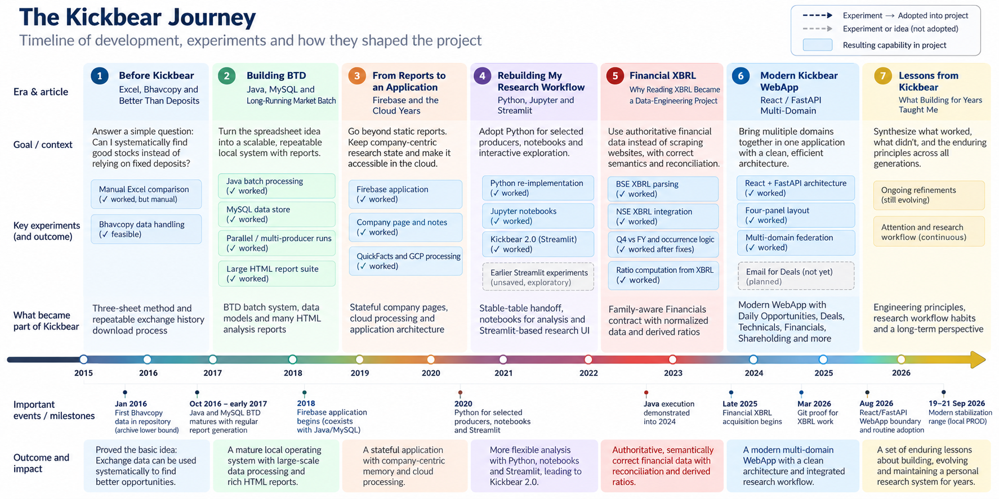
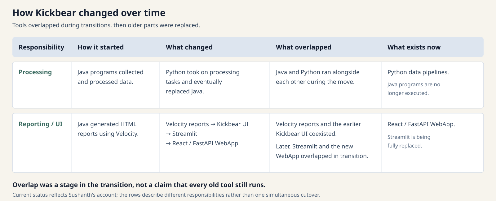

> This is a series of blog posts written by AI while reviewing my project, its been written from a 3rd person perspective

Kickbear began with a task Sushanth repeated in a spreadsheet: comparing market files to see what had changed. Over the years, it grew into a tool for collecting data, studying companies and keeping track of what deserved another look.

One lesson appeared again and again. The biggest gains often came from avoiding work that had already been done. Faster code helped, but checking whether the data had changed could save much more time.

The Java programs learned to fetch pages only when they were due for an update. Cloud programs compared dates and processed changed companies. RadarSystem prepared results before the interface opened. Later financial and technical pipelines reused results when their inputs stayed the same.

The tools changed, but the practical question remained: what needs to run again, and what can safely be reused?

*Click the timeline to open the full-size image in a new tab. Click it again in the browser to zoom in.*

## Avoid repeating unchanged work

Running several downloads at once helped the early MC crawler. Even so, some recorded runs still took roughly two and a half to six hours. There were many pages to fetch, and requests had to be spaced out.

A better schedule reduced the work. Weekly or monthly data did not need a daily download. A page that was not yet due for an update could be skipped. Later programs compared saved data and file fingerprints to decide what needed processing.

Reusing results still required checks. In one Technicals run with no changed inputs, the analysis itself took only 0.048 seconds. The complete run took 258.16 seconds because it still checked the inputs, database and published results.

The aim was to save work while keeping the results reliable.

## Use reliable sources and keep the originals

Kickbear gradually used more data published by the exchanges. Bhavcopy files supplied daily market data. Exchange files and APIs supplied deals, delivery data and announcements. BSE and NSE XBRL filings supplied structured financial information.

MC still contributed company information and historical data. Website tables provided another way to check a value. Different sources also covered different companies.

Even exchange data could be incomplete or difficult to interpret. Keeping the original files, source names and revision details made it possible to investigate a result later. If a parsed value changed, Sushanth could check whether the source had changed or the program had read it differently.

## Keep conflicting values available

A chart or report usually needs one value to display. That does not mean the other source values should be discarded.

The financial pipelines learned to compare observations before choosing a value. Two sources might agree exactly, differ slightly, use different definitions or disagree enough to need review. The selected value could be displayed while the alternatives and reasons remained available.

The same approach helped elsewhere. Logs preserved details behind summary timings. Tests and saved outputs documented the replacement of the old direction model. Separate build folders kept published results available for inspection.

Keeping that history made later changes easier to explain and check.

## Choose tools that fit the task

Java was familiar to Sushanth when he started automating the data flow. MySQL suited a local personal project. Firebase later supported a company-focused web interface and saved user actions. Jupyter made it easier to explore questions, and Streamlit turned analysis into pages quickly. React and FastAPI became useful when he needed a more flexible layout with several connected panels.

Some designs also became too heavy for the task. XBRL version 3.1 kept useful evidence, but one embedded data structure reached 1.03 GB and a recorded rebuild took 12 hours. Version 3.2 kept the evidence while reducing the corresponding compact catalog to about 79.7 MB and updating only changed groups.

Kickbear serves one person's research workflow. It needs reliable data and safe updates, but its current TEST and PROD environments both run locally. PROD is the selected dataset for regular use, rather than a cloud service.

## Replace parts in stages

Kickbear changed through a series of transitions.

Processing started with Java. Python later took over selected tasks, so both were used for a period. Python eventually replaced Java. Sushanth no longer executes Java programs.

Reporting started with HTML reports generated by Java using Velocity. The earlier Kickbear UI arrived while those reports were still in use. Streamlit later became the review interface, followed by the React/FastAPI WebApp. Streamlit and the new WebApp overlapped during the move, and Streamlit is now being fully replaced.

Other parts changed at their own pace. Firebase added web interaction and personal state while MySQL and HTML reports were still active at that time. GCP took on some scheduling, downloads, file storage and history processing.

Clear connections between programs helped these moves. A program could change how it produced a MySQL table while another program continued reading it. Prepared data files let the interface change without moving the calculations. APIs later let React request financial views without opening the source files itself.

The overlap was part of the transition. It does not mean every older tool still runs today.

*Each row shows how a responsibility started, what changed, what overlapped during the move and what exists now.*

## Prepare results before displaying them

The earliest programs often calculated results and printed reports in the same run. Later versions separated those jobs. BTD wrote report tables that Velocity displayed. Firebase stored prepared data for the web interface. RadarSystem prepared dated files for Streamlit. The current WebApp reads compact databases and other published files from the domain pipelines.

Here, publishing means saving checked results in a form the application can read. It does not mean putting them on the internet.

This separation made the interface more useful. A long calculation did not need to run every time Sushanth opened a page. The interface could change while the analysis stayed in its own pipeline. If a new build failed its checks, the previous successful data could remain available.

## Help the user decide what to review and remember

Kickbear's purpose has always included reducing the amount of information Sushanth needs to inspect. Excel sorted the biggest changes. HTML reports organized different research questions. Announcements, price triggers and Deals Mail brought updates to his attention.

Today, Deals and Daily Opportunities help him narrow a large amount of data into a smaller set to review. Sushanth describes them as his most-used entry points, although both still need improvement.

The way updates reach him has changed. Deals Mail used email to bring information to him. Modern Deals requires him to open the local application. The newer version has not yet restored that email workflow.

Watchlists help him remember his research. He reviews a company, decides whether to retain it, adds it to a specific list and later returns mainly to those saved companies. The saved entry price helps him see how the price has moved since that point.

These details matter because a useful report also needs a practical way to reach the user and support the next review.

## Keep clear notes as the project grows

As Kickbear grew, it became harder to know which file, build or document described the current system. The project added a small set of guides to make this clearer: `MAP` explains where responsibilities belong, `STATE` records the accepted current position, and `WORKING_RULES` describes how changes should be made and checked. Operating guides and completed handoffs provide further detail.

These notes became especially useful during AI-assisted development. Faster code changes made it more important to record what had been accepted, what still needed work and which older designs had been replaced.

Most of Kickbear's history came before this recent use of AI. The lesson from the newer work is practical: clear records help both the developer and an assistant continue without repeatedly rediscovering the system or bringing back an outdated approach.

## The purpose lasts longer than the tools

Kickbear began with a comparison between two market files. It gradually gained data loaders, history stores, company identities, reports, saved user state, notebooks, financial evidence and a dedicated WebApp.

What held the project together was Sushanth's need to review companies with limited time, avoid expensive repeated work, check imperfect data and remember earlier decisions. He also wanted substantial company information together on one screen.

Kickbear remains a work in progress. Deals and Daily Opportunities still need refinement, and the current application will continue to change as Sushanth's questions and review habits change.

The project shows how a personal tool can grow over years: solve the immediate problem, keep useful evidence, replace parts when needed and record enough context to continue.

---

*Kickbear is a personal research environment. Nothing in this series is a recommendation to buy or sell a security.*

